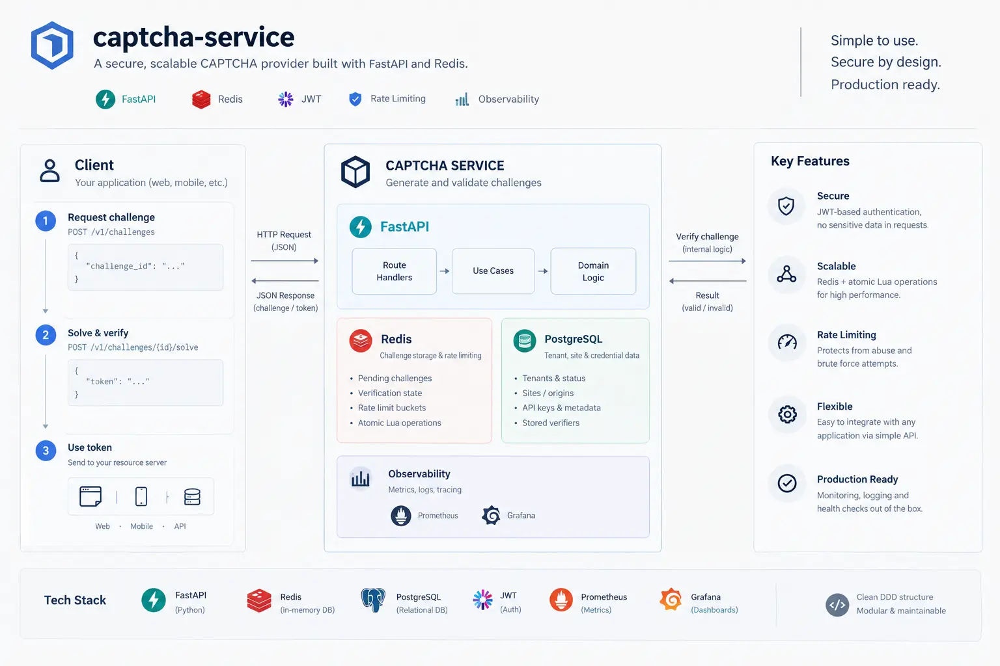

<p align="center">
  
</p>

<h1 align="center">captcha-service</h1>

<p align="center">
  A self-contained CAPTCHA service: hands out image challenges, checks answers, and issues
  short-lived signed tokens that other servers redeem to prove a human solved a challenge.
  Runs with one command, keeps all its state in Redis, and never stores a solution in plain text.
</p>

> **Live demo:** [in here](https://captcha-service-web-demo.vercel.app/) — a Next.js login form that exercises the full flow end to end (fetch challenge → solve → server-side verify).

## Running it

```bash
docker compose up -d --build
```

That starts Redis and the API together. The API is on `http://127.0.0.1:8000`, Redis on `127.0.0.1:6379` — both bound to loopback only, so nothing is exposed to the LAN. Without Docker: `docker compose up -d redis`, then `uv sync && uv run uvicorn captcha_service.api.app:app --port 8000`.

Settings come from `.env` (required: `CAPTCHA_INTERNAL_API_KEY` and `CAPTCHA_JWT_SECRET` — the app refuses to start without them). Shortcuts:

```bash
make up        # start the stack; creates .env with two fresh random secrets on first run
make test      # pytest suite against the running Redis
make metrics   # adds Prometheus + Grafana, dashboard pre-provisioned
```

`make metrics` brings the whole stack up with Prometheus scraping `/metrics` and Grafana at `http://127.0.0.1:3000` with the "CAPTCHA service" dashboard already provisioned — open it and the panels are live (anonymous viewer access, `admin`/`admin` if you want the full UI). The runbook at the bottom explains what to look at when something breaks.

## What it does, end to end

```
 client                 captcha-service                 resource server
   |                          |                               |
   |-- POST /challenges ----->|  generate code + PNG,         |
   |<-- id, image, expiry ----|  store hash in Redis          |
   |                          |                               |
   |-- POST /solve ---------->|  compare with stored hash     |
   |<-- JWT ------------- ----|  (wrong answer burns the      |
   |        challenge)        |                               |
   |                          |                               |
   |    client passes token + id to the resource server       |
   |                          |                               |
   |                          |<--- POST /internal/verify ----|
   |                          |  1. check X-Internal-Key      |
   |                          |  2. check JWT signature/exp   |
   |                          |  3. atomically consume the    |
   |                          |     solved challenge          |
   |                          |---- 200 valid (once) -------->|
```

### 1. `POST /v1/challenges` — get a puzzle

Send the action you're protecting (`{"action": "login"}`). The server picks 6 random characters (uppercase + digits, `secrets`-based, so no modulo bias), renders them into a distorted PNG, and stores only the **SHA-256 hash** of the code in Redis — the plaintext solution never touches storage, and it isn't in the response either.

You get back `challenge_id`, the image as a base64 data URL (drop it straight into ``), and `expires_at`. Challenges live 300 seconds by default.

### 2. `POST /v1/challenges/{id}/solve` — answer it

Send the action and what you read in the image. One try counts:

- **Correct** → the challenge flips to `solved`, you get an HS256 JWT. Its claims bind it to that exact challenge id and action, and it expires 300 seconds after issue.
- **Wrong** → the challenge flips to `failed` and is dead on the spot. No retry counter, no second chance — each brute-force attempt needs its own fresh challenge, which makes guessing economically pointless against the 31.7 billion possible 6-char codes.
- Already solved / failed / expired → `409`. Unknown id → `404`.

Every state write is a compare-and-set inside one Lua script keyed on a version counter, so two simultaneous solves of the same challenge can't both win — one gets the token, the loser gets `409 stale_challenge`.

### 3. `POST /v1/internal/verify` — redeem the ticket (server-to-server)

The resource server calls this with `{challenge_id, action, token}` and the `X-Internal-Key` header (compared in constant time). Three gates, in order:

1. **Header** — wrong or missing key, same terse `401` for both.
2. **Token** — the JWT signature, expiry, and issuer are checked; the token must be the one issued for *this* challenge id and *this* action or it's `400`.
3. **Redemption** — one atomic Lua script does all of the following as a single Redis operation:
   - if the challenge is `solved`: delete it, remove it from the expiry index, and record the verdict (bound to the SHA-256 of the exact token presented) for 120 seconds. Return **valid**.
   - if the verdict record exists and the *same* token hash retries: hand the recorded verdict back once, then delete the record. This is the network-glitch safety net — the caller that got disconnected mid-response retries and still succeeds. **Exactly one** retry reads it.
   - anything else (different token retrying, record and challenge both gone) → `404`, and a *different* token while a record is still alive → `400`.

The upshot: **one solved challenge buys exactly one successful verify, plus at most one replay of the same token.** Nobody can verify twice with a re-minted token, and the record on file can't be spent a second time either, even by its original owner.

## Why this holds up under concurrency

Everything a client can trigger that mutates state goes through a registered Lua script — Redis runs each atomically, with no other command slipping in between the read and the write:

- **solve** → one Lua script reads the stored state, compares the answer digest and commits the transition in a single atomic step — there's no read-modify-write window left, so concurrent solvers can't both win and honest callers never see a version race. A solver that lands after the challenge is already solved re-mints a token with no write at all (the aggregate's version doesn't move), so retry storms are free.
- **verify** → the redeem script above. Checked under fire: 16 simultaneous verifies of one solved challenge produce one `200` and fifteen hard rejections. 50 concurrent saves of a fresh challenge produce exactly one winner.

Read paths (`get`, the expiry lookup) touch nothing mutable, so they can't race.

## Challenge lifecycle

```
            new / solve(correct)
   issued ────────────────► solved ──(first verify / replay)──► [deleted from Redis]
      │
      ├─ wrong answer ────► failed                    (terminal, deleted after TTL)
      └─ 5 min pass ──────► expired                   (terminal, deleted after TTL)
```

Terminal states are final. Each challenge hash carries a Redis TTL of `expires_at + 10 min grace` so expired rows get swept by Redis itself, and a sorted set (`challenge:expiry`) ordered by expiry timestamp is kept for due-for-expiry lookups. A background sweeper (default every 60 s, `CAPTCHA_EXPIRY_SWEEP_INTERVAL_SECONDS`) flips overdue issued challenges to expired for real — so the sorted set stays bounded and the expiry transition actually happens rather than being inferable only at read time. Set the interval to 0 to disable it.

## Endpoints

| Method | Path | Auth | What it does |
|---|---|---|---|
| POST | `/v1/challenges` | none | Issue a new challenge. `201` with `challenge_id`, `image` (data URL), `expires_at`. The same image is also served at `GET /v1/challenges/{id}/image`. |
| POST | `/v1/challenges/{id}/solve` | none | Submit `{action, solution}`. `200` + `{token, expires_at}`; `400` wrong answer (burned); `409` not solvable; `404` unknown. Solving again on a solved challenge re-mints a token with zero storage writes. |
| GET | `/v1/challenges/{id}/image` | none | The rendered challenge as raw PNG bytes (content type `image/png`), with an `ETag` (the challenge id) — a matching `If-None-Match` gets `304`. Lighter than the base64 data URL in the create response. |
| POST | `/v1/internal/verify` | `X-Internal-Key` | Verify + redeem a token. `200` on first use and on its single replay; see above for the rejection codes. |
| GET | `/v1/health` | none | Liveness with substance: pings Redis, reports whether the Lua scripts are still loaded. `503` when the store is unreachable. |
| GET | `/metrics` | none | Prometheus scrape endpoint (bound to loopback in dev). Latency per route/status, verify outcomes, solve right/wrong, stale CAS writes, Redis errors, expiry-queue size. |

Interactive docs at `/docs`.

Log line format is JSON (one object per line) and every request carries an `X-Request-ID` — set `X-Request-ID` on the way in to correlate, or read the minted one from the response header and quote it in a bug report.

## Builtin abuse controls

- **Rate limiting per client IP** (token bucket, state kept in the same Redis): issuance burst 15 / sustained 15 per second, solve burst 30 / sustained 10 per second — `CAPTCHA_RATE_LIMIT_*` to tune, `CAPTCHA_RATE_LIMIT_ENABLED=false` to disable. Rejects come back `429` with a `Retry-After` header. The limiter **fails open** on a Redis outage: protecting availability beats protecting the CPU when the store is gone, and the failure is visible in `captcha_redis_errors_total`. Keys bucket by socket peer IP — `X-Forwarded-For` is deliberately ignored; re-point at your trusted proxy header when a proxy is deployed.
- **Request bodies are capped at 16 KiB** (`413` above that, checked against `Content-Length` before reading, and mid-stream for chunked uploads), and the verify endpoint's challenge id / action / token are length- and format-bounded at the schema layer.
- **Missing vs wrong `X-Internal-Key` return the identical `401`**, in constant time.
- **Redis calls carry socket timeouts** (2 s connect/read by default, `CAPTCHA_REDIS_SOCKET_*`), so a wedged Redis stalls requests instead of hanging them.

`docker-compose.prod.yml` is the production-shaped overlay: Redis password required + **no host port mapping at all** (internal network only), `/metrics` and the API reachable behind your own proxy, `volatile-ttl` with AOF persistence, non-root read-only container with dropped capabilities. See [docs/security-hardening.md](docs/security-hardening.md) for the remaining pre-production checklist.

## Configuration (env vars, `CAPTCHA_` prefix)

| Variable | Default | Notes |
|---|---|---|
| `INTERNAL_API_KEY` | required | shared secret for the internal verify endpoint |
| `JWT_SECRET` | required | signing key for solve tokens |
| `REDIS_URL` | `redis://127.0.0.1:6379/0` | pinned to IPv4 on purpose — see below |
| `REDIS_GRACE_SECONDS` | 600 | extra TTL beyond expiry so terminal states stay observable |
| `EXPIRY_SWEEP_INTERVAL_SECONDS` | 60 | background sweeper cadence; 0 = off |
| `CHALLENGE_TTL_SECONDS` | 300 | how long a challenge stays solvable |
| `TOKEN_TTL_SECONDS` | 300 | JWT lifetime after a correct solve |
| `REDEMPTION_RETENTION_SECONDS` | 120 | how long a verdict stays on file for retries; must be < token TTL |
| `CAPTCHA_LENGTH / WIDTH / HEIGHT` | 6 / 280 / 90 | image dimensions and code length |
| `RATE_LIMIT_ENABLED` | `true` | per-IP token buckets on public endpoints |
| `CHALLENGE_RATE_MAX / _PER_SECONDS` | 15 / 15 | issuance bucket size / refill per IP |
| `SOLVE_RATE_MAX / _PER_SECONDS` | 30 / 10 | solve bucket size / refill per IP |
| `INTERNAL_API_KEY_PREV` | unset | previous key during a rotation window; while set, both authenticate |
| `JWT_PRIVATE_KEY_PEM / JWT_PUBLIC_KEY_PEM` | unset | with `JWT_ALGORITHM=RS256`/`EdDSA`: asymmetric signing (verifiers hold only the public key and cannot mint) |
| `REDIS_SOCKET_TIMEOUT / _CONNECT_TIMEOUT` | 2.0 / 2.0 | per-call Redis socket ceilings (seconds) |

About `REDIS_URL`: `localhost` on Windows resolves to both `127.0.0.1` and `::1`. A Redis pool can quietly fill with connections to *two different servers*, and everything atomic suddenly isn't. Hence the explicit IPv4 default.

## Layout

Roughly hexagonal — the domain knows nothing about Redis or JWT:

```
src/captcha_service/
├── domain/            entities, value objects, state machine, ports (interfaces)
│   └── challenge.py     the Challenge aggregate + all its invariants
├── application/       use cases (issue / solve / verify) + DTOs + ports for clock, tokens
├── infrastructure/    Redis repository (CAS writes, Lua), proof ledger, JWT, image gen, clock
├── api/               FastAPI routes, schemas, exception handlers, auth dependency
└── core/settings.py   typed pydantic settings, fail-fast on missing secrets
```

Swapping Redis for anything else means writing one adapter that keeps the `ChallengeRepository` and `ProofLedger` contracts; nothing above the ports changes.

## Runbook

For the on-call version of you. The dashboard (**make metrics** → Grafana) is the entry point; `curl http://127.0.0.1:8000/metrics` shows the same numbers when you don't want UI.

**500s spike.** Three panels tell you almost everything:

- `captcha_redis_errors_total` climbing → the store is the problem, not the app. Check `docker compose logs redis`, and `/health` (`lua_scripts` all true means script cache intact; all false means Redis was wiped/restarted recently — scripts reload automatically on next use, but check for data loss). The 500 shape follows the failure mode, so errors trend before the status count does.
- `captcha_stale_challenge_writes_total` climbing without Redis errors → version races under load. Increase `uvicorn --workers` rather than scaling instances; the CAS is per-instance and safe while there's one Redis.
- `captcha_stale_challenge_writes_total` flat, `captcha_http_request_duration_seconds_count{status="500"}` still climbing → a bug filed in app code reads the traceback through logs (JSON lines, `request_id` per request).

**429s rule the traffic.** `captcha_http_request_duration_seconds_count{status="429"}` rate is the per-IP token bucket working. `captcha_challenges_awaiting_expiry` along with it means the attacker inflated the expiry index; the sweeper drains it (and `captcha_challenges_expired_total` grows at the same pace the sweeper runs). Tune the bucket through `CAPTCHA_CHALLENGE_RATE_MAX` / `CAPTCHA_SOLVE_RATE_MAX` if legit users are caught in it.

**expiry index growth.** `captcha_challenges_awaiting_expiry` continuous growth means the sweeper is stuck or the challenge rate jumped. First check the sweeper's stderr via logs; if the service is just hot, it burns through eventually, since `limit` per sweep is bounded.

**Verify (the internal endpoint), when your upstream calls you.** Outcome distribution is the panel to watch:

- `captcha_redeem_outcomes_total{outcome="conflict"}` nonzero → someone replays a consumed proof with a re-minted token. The design makes it harmless (they get 400) but a sustained rate is an actual attack to log.
- `outcome="replay"` small and bounded → the network-retry path. If it goes high, your upstream is flaky or retrying too aggressively.
- `outcome="not_found"` spike → upstream presenting expired challenges (challenge TTL vs retry policy mismatch) or re-using ids.

**Wrong-solve ratio.** `captcha_solve_results_total{result="wrong"}` trending steady-high with lower total issuance means the challenge is hard or OCRs weak. A *burst* of wrongs against specific ids followed by silence is someone probing — the answer-key burn means they lose the challenge each try.

---

## Related repos

- **[captcha-service-web](https://github.com/tahmasbi-dev/captcha-service-web-demo)** — the Next.js demo login form. Fetch a challenge, solve it, then have the login route redeem the token server-to-server with this service (`X-Internal-Key` + `/v1/internal/verify`). The fastest way to see the whole flow working.